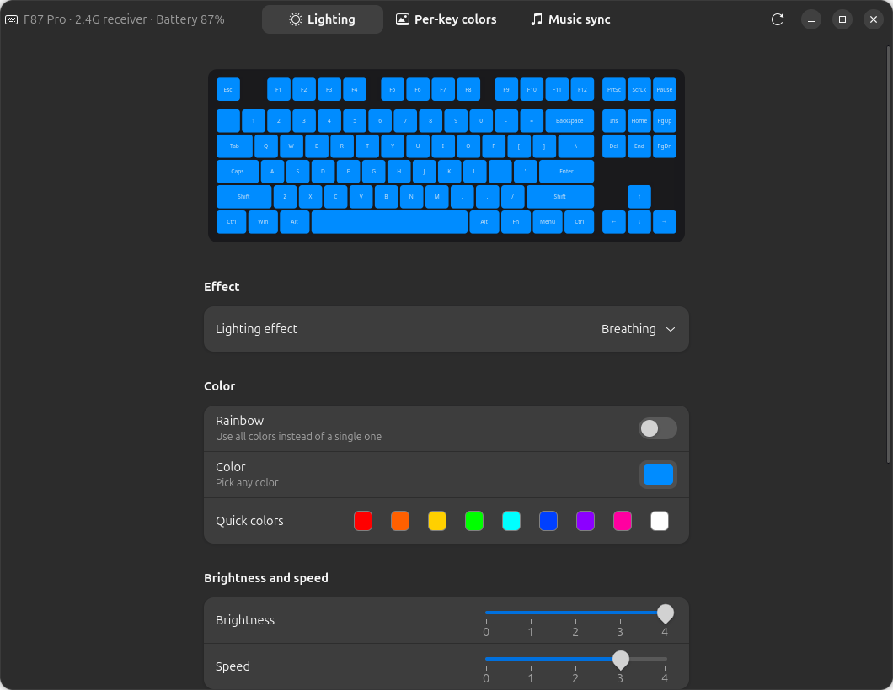
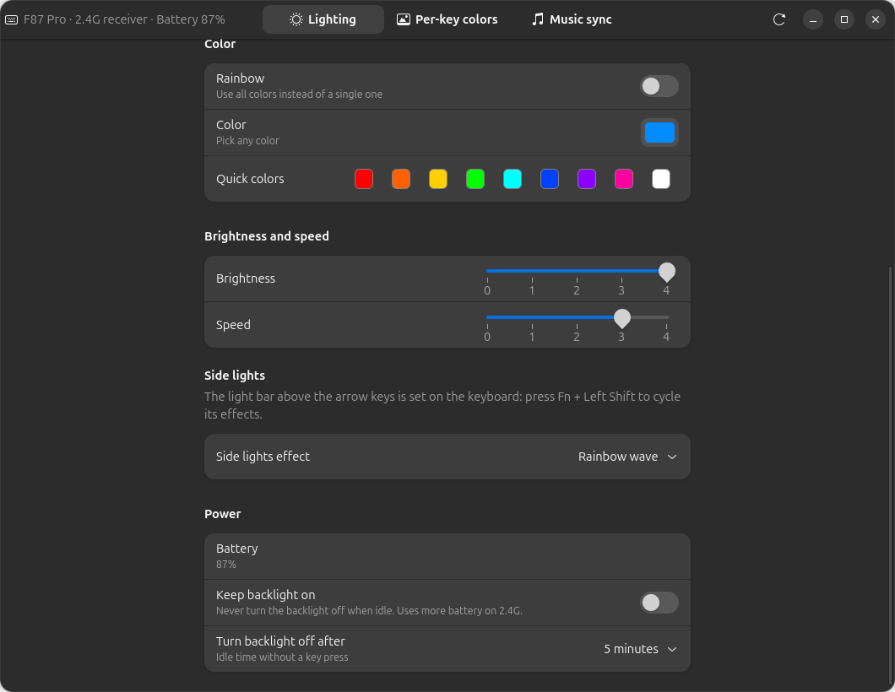
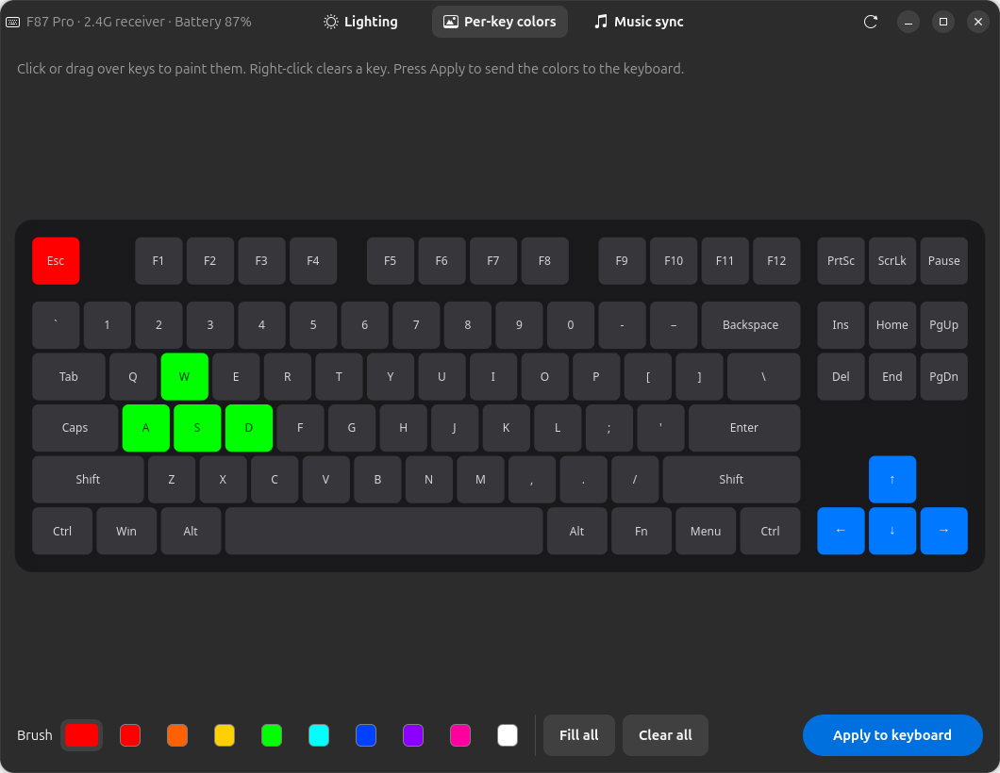
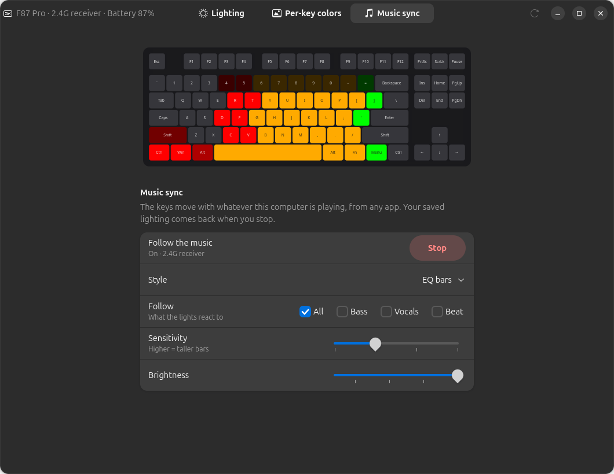

#  AULA F87 Control

[](https://github.com/RadianceADM/aula-f87-control/actions/workflows/ci.yml)
[](https://github.com/RadianceADM/aula-f87-control/releases/latest)
[](https://pypi.org/project/aula-f87-control/)
[](LICENSE)

Control the lighting of the **AULA F87 / F87 Pro** mechanical keyboard on **Linux and Windows**,
without AULA's own software.


## Features

- **Lighting effects.** 14 built-in effects in any color or rainbow, with brightness and speed.
  Changes are sent to the keyboard as you click.
- **Per-key colors.** Paint individual keys on an on-screen keyboard.
- **Music sync.** The keys move with whatever your computer is playing, from any app. Styles:
  EQ bars, meter colors, rainbow, and beat pulse. Close the window and the keyboard goes back
  to its own lighting.
- **Battery level** (over 2.4G) and **sleep timer.** Keep the backlight always on, or choose
  when it turns off.
- **Side lights** effect.
- **Top-bar icon** (Linux). A quick menu for music sync, keep backlight on, colors, effects and
  brightness, with the battery % next to the icon. It starts at login and stays in the top bar
  when you close the window.
- Works over the **USB cable** and the **2.4G receiver**.
- A **command line** for scripts and shortcuts.
- Needs no drivers and no admin rights once set up. Settings are stored in the keyboard
  itself, so they stay when you unplug it or use another computer.
- **Guards the keyboard's settings.** Every change is checked before it is written and read back
  afterwards. If something goes wrong, the last good settings are put back. See
  [Is it safe?](#is-it-safe)

## Supported keyboards

| Keyboard | USB cable | 2.4G receiver | Bluetooth |
|---|---|---|---|
| AULA F87 Pro | ✅ tested | ✅ tested | ❌ not supported |
| Other AULA boards with the same USB IDs (`258a:010c` cable, `3554:fa09` receiver), e.g. F87, F87 TK, F75, F99 | may work | may work | ❌ |

Tested on Ubuntu 26.04 with an F87 Pro, over both the cable and the 2.4G receiver. Per-key
colors were only tested over the cable.

The Windows version runs the same keyboard and audio code through `hidapi` and `soundcard`.
That code path was tested with the keyboard on Linux. CI checks on Windows that the installer
works and the window opens, but the app hasn't been used with a keyboard on a Windows PC yet,
so reports are welcome.

## Install

### Quick install

**Linux** (Ubuntu, Debian, Fedora, Arch). Paste into a terminal:

```sh
curl -fsSL https://raw.githubusercontent.com/RadianceADM/aula-f87-control/main/scripts/install-linux.sh | bash
```

**Windows 10 / 11.** Paste into PowerShell (no admin needed):

```powershell
irm https://raw.githubusercontent.com/RadianceADM/aula-f87-control/main/scripts/install-windows.ps1 | iex
```

Both scripts install the [latest release](https://github.com/RadianceADM/aula-f87-control/releases/latest):

- **Linux:** the script asks for your password to install the required packages and the udev
  rule. It then adds **AULA F87 Control** to the app menu and the `aula-f87-control` command,
  and starts the app at login with its [top-bar icon](#top-bar-icon-linux).
- **Windows:** the script installs Python with winget if it's missing, installs the app from
  [PyPI](https://pypi.org/project/aula-f87-control/) with pip, and adds **AULA F87 Control** to
  the Start menu.

Run the same command again to update. To uninstall:

```sh
curl -fsSL https://raw.githubusercontent.com/RadianceADM/aula-f87-control/main/scripts/install-linux.sh | bash -s -- --uninstall
```

```powershell
$env:AULA_UNINSTALL = 1; irm https://raw.githubusercontent.com/RadianceADM/aula-f87-control/main/scripts/install-windows.ps1 | iex
```

It's a good habit to read a script before you run it:
[install-linux.sh](scripts/install-linux.sh), [install-windows.ps1](scripts/install-windows.ps1).
To install by hand instead, follow the steps below.

### Ubuntu / Debian (manual)

```sh
sudo apt install git python3-gi gir1.2-gtk-4.0 gir1.2-adw-1 python3-numpy pipewire-bin
git clone https://github.com/RadianceADM/aula-f87-control.git
cd aula-f87-control

# Let your user talk to the keyboard without root (one time)
sudo cp udev/70-aula-f87.rules /etc/udev/rules.d/
sudo udevadm control --reload-rules && sudo udevadm trigger

./install.sh
```

Open **AULA F87 Control** from the app menu. If the keyboard isn't found, unplug and replug the
cable or receiver once, so the new permission applies.

`install.sh` adds the `aula-f87-control` command, the app-menu entry and its icon, all running
the app from the cloned folder, so keep the folder where it is. It also makes the app start at
login with its [top-bar icon](#top-bar-icon-linux), and starts it right away. Use
`./install.sh --no-autostart` to skip both.

- **Update:** run `git pull` and then `./install.sh` again. This restarts the app.
- **Uninstall:** run `./install.sh --remove`.

On other distributions, install the same packages under their own names, then follow the
steps above:

- **Fedora:** `python3-gobject gtk4 libadwaita python3-numpy pipewire-utils`
- **Arch:** `python-gobject gtk4 libadwaita python-numpy pipewire`

### Arch Linux

The package isn't on the AUR yet, because AUR sign-ups are paused for now. You can build the
same package straight from this repository:

```sh
git clone https://github.com/RadianceADM/aula-f87-control.git
cd aula-f87-control/packaging/aur
makepkg -si
```

The package installs the udev rule, the menu entry and the icons. Start at login turns
itself on the first time you open the app. On GNOME, install
`gnome-shell-extension-appindicator` to get the top-bar icon.

### Windows 10 / 11 (manual)

1. Install **Python 3.10 or newer** from [python.org](https://www.python.org/downloads/).
   In the installer, tick **"Add python.exe to PATH"**.
2. Open **Command Prompt** or **PowerShell** and run:

   ```
   pip install aula-f87-control
   ```

3. To start the app, press **Win + R**, type `aula-f87-control-gui` and press Enter. You can also
   run `aula-f87-control` in a terminal.

   To pin the app to Start or the taskbar, find the program with `where aula-f87-control-gui`,
   then right-click it and choose **Pin to Start**.

No driver is needed. Close AULA's own software first if it is running.

- **Update:** `pip install --upgrade aula-f87-control`
- **Uninstall:** `pip uninstall aula-f87-control`

### macOS (untested)

Install it with `pip3 install aula-f87-control`, then run `aula-f87-control-gui`.
macOS may ask you to allow **Input Monitoring**. Music sync needs a loopback audio device,
such as BlackHole, set as the default input.

## Using the app

The Ubuntu app uses GTK and looks native on GNOME. Windows and macOS get a simpler window with
the same tabs and features, but without the top-bar icon and without starting at login.
To see the version and what changed, open **About**. On Linux it's in the main menu (☰) and
the top-bar menu. On Windows and macOS it's a button at the top of the window. On Linux you can open that one too, with `aula-f87-control gui --tk`
(needs `python3-tk`).

### What is saved where

- **In the keyboard:** lighting, per-key colors, side lights and the sleep timer. These stay
  when you unplug the keyboard or use another computer.
- **On this computer:** whether music sync is on, its style, sensitivity and brightness, the
  last tab, the brush color and the window size.
  - Linux: `~/.config/aula-f87-control/settings.json`
  - Windows: `%APPDATA%\aula-f87-control\settings.json`

  A copy of the keyboard's last good settings is kept next to it in `cache.json`. **Repair**
  uses it (see [Troubleshooting](#troubleshooting)).

  **Closing the window stops music sync,** and the keyboard goes back to its own lighting
  within a second. If music sync was on, it starts again when you open the window. It also
  restarts when the keyboard comes back after being unplugged or asleep. Press **Stop** to
  keep it off.

### Lighting



- **Lighting effect.** Pick one of the built-in effects. *Custom per-key* shows your painted keys.
- **Color.** Pick any color, or click a quick color. Picking a color turns Rainbow off. If the
  current effect can't use a color, it switches to *Static*.
- **Rainbow.** Use all colors instead of a single one.
- **Brightness** and **Speed.** Range from 0 to 4. Speed only applies to animated effects.
- **Side lights.** Choose the effect of the lights on the sides of the case.
- **The light bar above the arrow keys** is controlled on the keyboard. Press **Fn + Left Shift**
  to cycle its effects (see [Troubleshooting](#troubleshooting)).

### Top-bar icon (Linux)

The keyboard icon in the top bar gives you quick access without opening the window. Over
2.4G, the battery level is shown next to it. Click the icon for this menu:

| Menu item | What it does |
|---|---|
| Keyboard name and battery | Shows the current connection |
| **Music sync** | Starts or stops music sync. *Music style* picks the look and *Follow* what it reacts to. |
| **Keep backlight on** | Turns the sleep timer on or off |
| **Color**, **Effect**, **Brightness** | Quick lighting changes, the same as in the window |
| **Open AULA F87 Control** | Shows the window. Launching the app from the app menu does the same. |
| **About** | Version, links and the changelog |
| **Start at login** | Turns starting at login on or off |
| **Repair keyboard settings** | Only shown when the keyboard's saved settings look damaged |
| **Quit** | Stops the app, including music sync |

Closing the window stops music sync, so the keyboard shows its own lighting again. The app
stays in the top bar. To keep music sync running with the window closed, start it from this menu.
Use **Quit** to stop the app.

The icon needs a top-bar tray. Ubuntu has one built in (the *Ubuntu AppIndicators*
extension). On other GNOME systems, install *AppIndicator and KStatusNotifierItem Support*.
KDE Plasma and most other desktops show it without any extra setup. If there is no tray,
closing the window quits the app as usual.

### Power



- **Battery.** Shows the level when the keyboard is on the 2.4G receiver. On the cable it
  charges, and the keyboard doesn't report a level.
- **Keep backlight on.** The backlight never turns off when idle. This uses more battery on
  2.4G.
- **Turn backlight off after.** Sets how long the keyboard waits without a key press before
  the backlight sleeps. Press any key to wake it.

### Per-key colors



Click or drag over keys to paint them with the brush color. Right-click a key to clear it.
**Fill all** and **Clear all** change every key at once. Press **Apply to keyboard** to save
the colors to the keyboard and switch it to the *Custom per-key* effect.

### Music sync



Press **Start** and play something. The keyboard follows any app's sound: Spotify, YouTube,
games, and so on.

| Style | Looks like |
|---|---|
| EQ bars | One column per frequency band. Bass on the left is red, mids are yellow, treble on the right is green. |
| EQ bars (meter colors) | The same bars, colored by height: the two bottom rows green, the middle two yellow, the top two red. |
| EQ bars (rainbow) | Each column has its own color. |
| Beat pulse | The whole keyboard flashes on the bass, with the color slowly changing. |

- **Follow.** Picks what the lights react to. Tick one or more:

  | Follow | What moves the lights |
  |---|---|
  | **All** (default) | The whole sound, from deep bass to cymbals |
  | **Bass** | Only the low end (30–300 Hz): bass lines and kick drums, spread over the whole keyboard |
  | **Vocals** | The singing voice. The keys glow while someone sings, centred on the column of the sung pitch: low notes on the left, high notes on the right. Drums, the bass and instruments spread wide in the stereo mix are filtered out, so the glow follows the vocal lines and goes dark between them. |
  | **Beat** | The kick drum. The keyboard bursts from the middle on every hit. |

  Ticked choices are combined. For example, **Bass + Beat** shows the bass line and flashes on
  every kick. With mono audio, *Vocals* can't separate the voice and acts as a mid-range filter.
- **Sensitivity.** Higher makes the bars taller. The app also adjusts to the volume on its own.
  The two lowest steps (0.35 and 0.2) cut the bars shorter, for loud, dense music that lights
  the whole board even at 0.5.
  With **All**, the bars rise at once and fall smoothly, without flicker.
- **Brightness.** How bright the music lights are.

Music sync sends temporary frames and saves nothing. Your normal lighting comes back about a
second after you press Stop. The other tabs are locked while it runs.

Over the cable the keyboard updates about 30 times per second. Over 2.4G it updates 12–20
times per second, because the radio can't take frames any faster.

## Command line

| Command | What it does |
|---|---|
| `aula-f87-control` | Open the window |
| `aula-f87-control status` | Show the effect, color, brightness, side lights, sleep and battery |
| `aula-f87-control set --effect static --color ff6000` | Solid orange |
| `aula-f87-control set --effect breathing --rainbow --speed 2 --brightness 3` | Rainbow breathing |
| `aula-f87-control set --side 1` | Side lights effect: 0 off, 1 rainbow wave, 2 rainbow together, 3 solid, 4 breathing |
| `aula-f87-control sleep never` | Keep the backlight always on |
| `aula-f87-control sleep 10` | Backlight turns off after 10 idle minutes |
| `aula-f87-control music --style bars --follow bass,beat` | Music sync until Ctrl+C. Styles: `bars`, `meter`, `rainbow`, `pulse`. `--follow`: `all` (default) or any of `bass`, `vocals`, `beat`. Other options: `--sensitivity 0.2–2`, `--brightness 0.1–1`, `--seconds N` |
| `aula-f87-control repair` | Put back the keyboard's last good settings (see [Troubleshooting](#troubleshooting)) |
| `aula-f87-control gui --tk` | Open the simpler Tkinter window, even on Linux |
| `aula-f87-control --background` | Start with only the top-bar icon. This is what runs at login. |
| `aula-f87-control --version` | Print the version |

You can give `--effect` as a number or as the start of a name: `off`, `static`, `breathing`,
`rainbow`, `flash`, `raindrops`, `ripples`, `twinkling`, `retro`, `neon`, `reactive`, `sine`,
`rotating`, `colorful`, `blossoming`, `custom`.

## Troubleshooting

**The keyboard stopped typing, or its side lights flash very fast.** The lights still work, but
no key presses arrive. This means the settings stored in the keyboard got damaged. The app
detects this, shows *The keyboard's saved settings look damaged* and offers **Repair**. Repair
writes back the last good settings this computer saw, or safe defaults if it never saw any. From
a terminal, run `aula-f87-control repair`. If the keyboard can't be reached at all, hold
**Fn + Esc** for 3 seconds for AULA's factory reset.

**"Permission denied on /dev/hidrawN" (Linux).** Install the udev rule from
[Ubuntu / Debian](#ubuntu--debian-manual), then unplug and replug the keyboard or receiver.

**"The 2.4G receiver is plugged in but the keyboard is not answering."** The keyboard is
asleep, switched off, or in Bluetooth mode. Press a key, and check the mode switch on the
keyboard. To stop it from falling asleep, turn on **Keep backlight on**.

**"No AULA F87 found."** Check the cable or receiver. On Windows, close AULA's own software.
Only run one lighting app at a time.

**AULA's web driver (hub.aulacn.com) says it can't read the keyboard.** The web driver supports
newer boards, not the original F87 Pro. Use this app instead.

**The light bar above the arrow keys doesn't follow the app or the music.** The keyboard
controls that bar itself. Press **Fn + Left Shift** to cycle its effects: off, rainbow wave,
rainbow all together, solid, and breathing. It ignores the temporary frames that music sync
uses. The keyboard also doesn't reliably apply changes to it from the computer.

**Music sync is on but the keys stay dark.** Make sure something is playing on the default
audio output. On Linux the app needs `pw-record` (`sudo apt install pipewire-bin`). Raise
**Sensitivity** if the music is very quiet.

**Battery shows "On USB power".** That's expected on the cable. The keyboard only reports its
level over 2.4G, and over 2.4G it shows "Charging" while the cable is plugged in.

**There's no icon in the top bar (Linux).** On Ubuntu, run
`gnome-extensions enable ubuntu-appindicators@ubuntu.com`. On other GNOME systems, install the
*AppIndicator and KStatusNotifierItem Support* extension (on Fedora and Arch the package is
called `gnome-shell-extension-appindicator`), then log out and back in. The app is probably
still running in the background, so opening it from the app menu shows its window.

**I don't want it to start at login.** Untick **Start at login** in the top-bar menu, or
reinstall with `./install.sh --no-autostart`.

**Changes over 2.4G take a moment.** Each change takes about half a second over the radio.

**"Another program is using the keyboard right now."** Only one program talks to the keyboard
at a time. This app, its music sync and the command line take turns. Stop music sync (or the
other program) and try again. AULA's own software doesn't take part in this, so close it
first.

**The keyboard restarted while I changed a setting.** It can do this when it's hurried. The app
spaces its writes out and checks the settings afterwards. Don't run AULA's software at the same
time.

**I want AULA's factory settings back.** Hold **Fn + Esc** for 3 seconds, as described in AULA's manual.

**Windows: `AttributeError: module 'hid' has no attribute 'device'`.** A different package
called `hid` is installed. Run `pip uninstall hid`, then `pip install --force-reinstall hidapi`.

## Is it safe?

- The app sends the same kind of commands as AULA's Windows software. They were worked out by
  the projects listed in [Credits](#credits) and checked on a real F87 Pro.
- Saving a setting writes it once to the keyboard's memory. Music sync and previews use
  temporary frames that are never stored, so they don't wear that memory.
- Damaged settings in the keyboard's memory can stop it from typing. The app guards against
  this:
  - It checks every settings block it reads. Blocks that don't look like real settings are
    read again, and never written back.
  - It writes only what changed, spaces out the writes, and checks the result.
  - If a write left damaged settings behind, it puts the previous ones back right away.
  - Only one program talks to the keyboard at a time, so music sync and setting changes never
    overlap.
  - When the keyboard's settings are damaged anyway, the app offers **Repair**.

- The app never touches the keyboard's firmware.
- This project isn't affiliated with AULA. Use it at your own risk.

## How it works

The keyboard has a vendor-specific USB HID interface. Over the cable the app exchanges 520-byte
*feature reports* with it. Over the 2.4G receiver it sends 20-byte *output reports*, and the
keyboard echoes each one. Both carry the same settings blocks: a 128-byte config, a 512-byte
color palette and a 378-byte per-key color map.

- **Linux:** the app talks to `/dev/hidraw*` directly and records audio with PipeWire's
  `pw-record`.
- **Windows and macOS:** it uses [hidapi](https://pypi.org/project/hidapi/) and
  [soundcard](https://pypi.org/project/soundcard/).

[docs/PROTOCOL.md](docs/PROTOCOL.md) documents every byte the app uses.

## Contributing

Bug reports and test results are welcome, especially from **Windows** users and owners of
**other AULA models**. Please open an issue with:

- your keyboard model and connection (cable or 2.4G),
- your operating system,
- the output of `aula-f87-control status`.

To work on the code:

```sh
python3 -m aula_f87                 # run from the source folder
AULA_F87_HID=hidapi python3 -m aula_f87 status      # use the Windows/macOS HID path on Linux
AULA_F87_AUDIO=soundcard python3 -m aula_f87 music  # use the Windows/macOS audio path on Linux
```

| File | Purpose |
|---|---|
| `aula_f87/hidio.py` | Raw HID access: Linux hidraw, or hidapi |
| `aula_f87/device.py` | Keyboard protocol: settings, per-key colors, live frames, battery, sleep |
| `aula_f87/music.py` | Audio capture, spectrum analysis and music-sync rendering |
| `aula_f87/gui.py` | GTK 4 / libadwaita app (Linux) |
| `aula_f87/gui_tk.py` | Tkinter app (Windows, macOS, and the Linux fallback) |
| `aula_f87/tray.py` | Top-bar icon: StatusNotifierItem and dbusmenu over D-Bus |
| `aula_f87/autostart.py` | Start at login (freedesktop autostart) |
| `aula_f87/settings.py` | App preferences kept on the computer |
| `aula_f87/data/` | App icon and top-bar icon |
| `packaging/` | Desktop entry and the Arch Linux (AUR) package |
| `docs/social-preview.png` | Banner for link previews (Settings → Social preview) |
| `aula_f87/effects.py`, `layout.py` | Effect list, presets, key positions and LED numbers |
| `aula_f87/__main__.py` | Command line and window selection |
| `scripts/` | Quick install scripts for Linux and Windows |

**Releases.** Bump `version` in `pyproject.toml`, add a section to `CHANGELOG.md`, then push a
tag that matches the version, such as `git tag v0.3.3 && git push origin v0.3.3`. The
`release.yaml` workflow then builds the wheel and the source archive, publishes the GitHub
release, and uploads to [PyPI](https://pypi.org/project/aula-f87-control/) through trusted
publishing, so no PyPI token is stored anywhere. CI tests installing with pip on Linux and
Windows, and runs both quick installers, on every push.

## Credits

This app builds on protocol research by:

- [marcoslor/Aula-F87-Controller](https://github.com/marcoslor/Aula-F87-Controller): 2.4G
  protocol and the audio stream
- [veysiemrah/aula-rgb-controller](https://github.com/veysiemrah/aula-rgb-controller): wired
  protocol and LED layout
- [OpenRGB](https://gitlab.com/CalcProgrammer1/OpenRGB): `SinowealthKeyboard10c` direct mode
- [ushineko/sanshoku #36](https://github.com/ushineko/sanshoku/issues/36) and
  [PyFlat/Device-Battery-Info #6](https://github.com/PyFlat/Device-Battery-Info/pull/6): the
  battery command

## License

[GPL-3.0-or-later](LICENSE).
